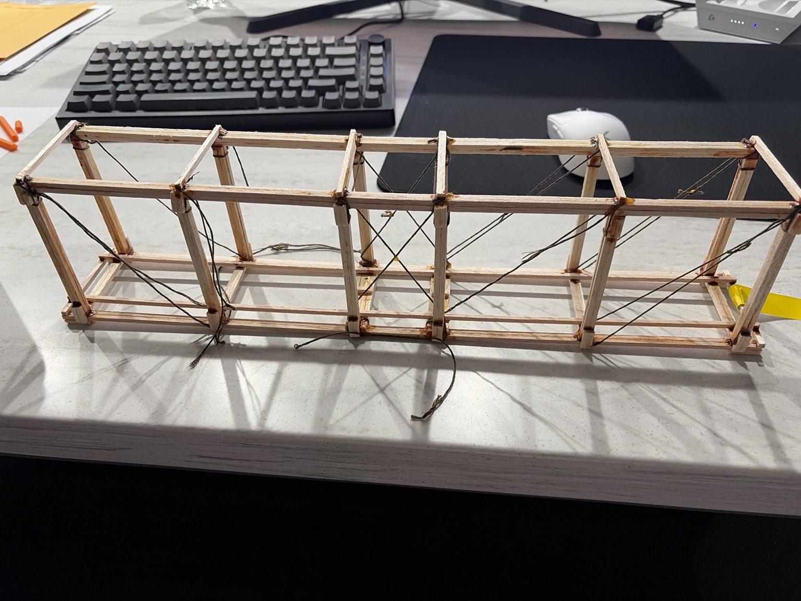

# MoDOT Bridge — 2026

[All projects](../../README.md) · [Project home](README.md) · [Story](build-log.md) · [Photos](photos.md) · [Videos](videos.md) · [Results](results.md) · [Sources](sources.md) · [Portfolio](https://github.com/MadeWithoutCaffeine/Michael-Polanczyk-Portfolio)

My first MoDOT bridge competition: researching designs, drawing my own plans, building a balsa bridge, and learning how much the string connections matter during testing.

## At a glance

| Field | Details |
| --- | --- |
| Status | Competition tested · results and post-test inspection documented |
| Goal | Build a lightweight bridge within the competition's material and design constraints. |
| My role | Final design, drawings, construction, string tensioning, and research. |
| Bridge mass | 28.65 g |
| Supported load | 13.2 lb, approximately 5.99 kg |
| Calculated load-to-mass ratio | Approximately 209:1; calculated from the reported measurements, not an official score. |
| Main lesson | Check string tension and anchoring as carefully as the wooden frame. |

## Project guide

| Section | What you'll find |
| --- | --- |
| [Story](build-log.md) | Design choices, construction, the test, and my reflection |
| [Photos](photos.md) | 19 construction photos and two post-test views |
| [Videos](videos.md) | Load-test footage, a results clip, and a wide view |
| [Results](results.md) | Measured load, the string failure sequence, and lessons for next year |
| [Sources](sources.md) | Competition references, media notes, and design credits |

*After the test. The frame was still standing when I received it back; the loose strings were the main visible change.*

## Background

I wanted to take part in the MoDOT bridge competition and apply what I was learning about design and structures. I explored several layouts before drawing my final design on paper. With limited time and no extra supplied material for experiments, I chose a simpler design and emphasized a strong base. Construction took roughly four to four and a half days.

## What happened during testing

The bridge weighed **28.65 grams** and supported **13.2 pounds**. I traced the early end of the test to two strings I had tensioned slightly too tightly. One loosened and another slipped, which disrupted the bracing and ended the test.

When I received the bridge back, it was still intact and appeared nearly unchanged apart from the two loose strings. That was useful to see, but it does not tell me how much more load it could have supported. My earlier estimate of around 90% efficiency was a personal expectation, not a verified result.

[Read the full testing account](results.md) · [Watch the videos](videos.md)

## Next steps

- For a future build, test string anchors and tension before the competition.

---

[All projects](../../README.md) · [Personal portfolio](https://github.com/MadeWithoutCaffeine/Michael-Polanczyk-Portfolio)
