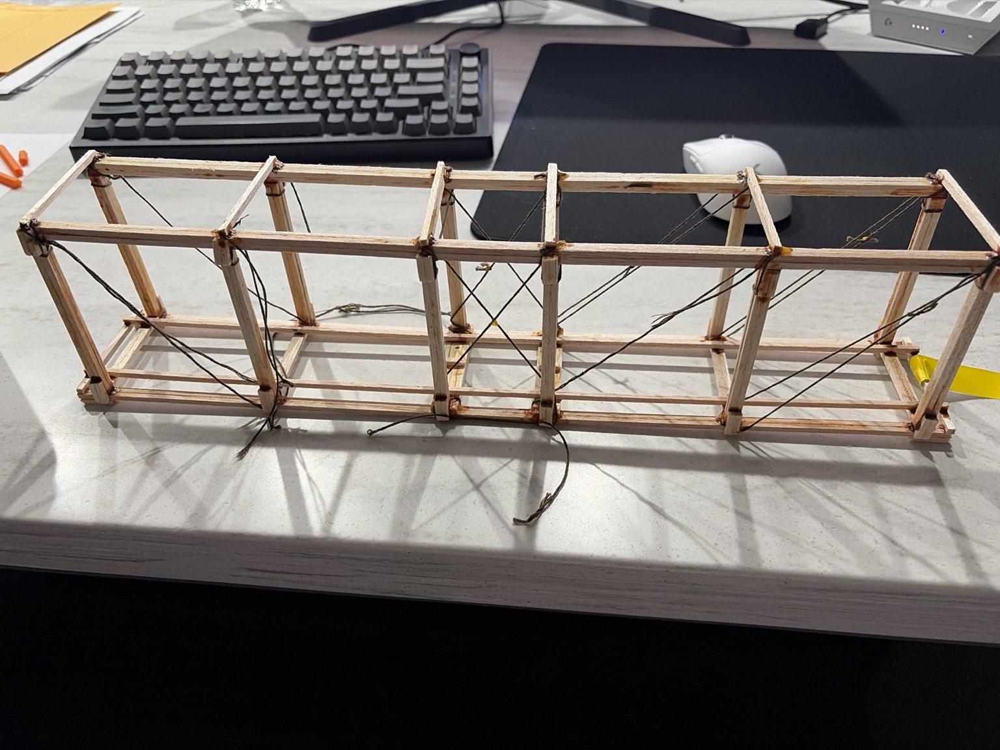
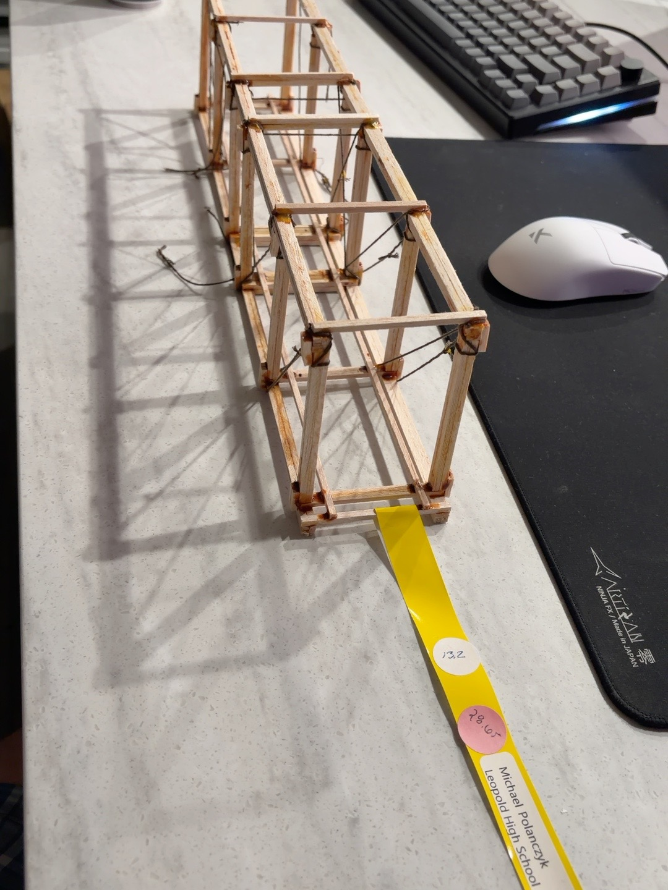

# MoDOT Bridge — Photos

[All projects](../../README.md) · [Project home](README.md) · [Story](build-log.md) · [Photos](photos.md) · [Videos](videos.md) · [Results](results.md) · [Sources](sources.md) · [Portfolio](https://github.com/MadeWithoutCaffeine/Michael-Polanczyk-Portfolio)

Construction photos in approximate sequence, followed by two views of the bridge after testing. Select a photo to open the larger image.

## Construction photo 01

## Construction photo 02

## Construction photo 03

## Construction photo 04

## Construction photo 05

## Construction photo 06

## Construction photo 07

## Construction photo 08

## Construction photo 09

## Construction photo 10

## Construction photo 11

## Construction photo 12

## Construction photo 13

## Construction photo 14

## Construction photo 15

## Construction photo 16

## Construction photo 17

## Construction photo 18

## Construction photo 19

## Post-test photos

The following photos show the bridge after it was returned from competition testing. The wooden frame is still standing, and loose strings are visible. The recorded result was **13.2 lb** with a bridge mass of **28.65 g**.

### Side view

### End view and competition tag

[Watch the competition videos](videos.md) · [Read the results](results.md)

[Back to project home](README.md)

[All projects](../../README.md) · [Project home](README.md)
