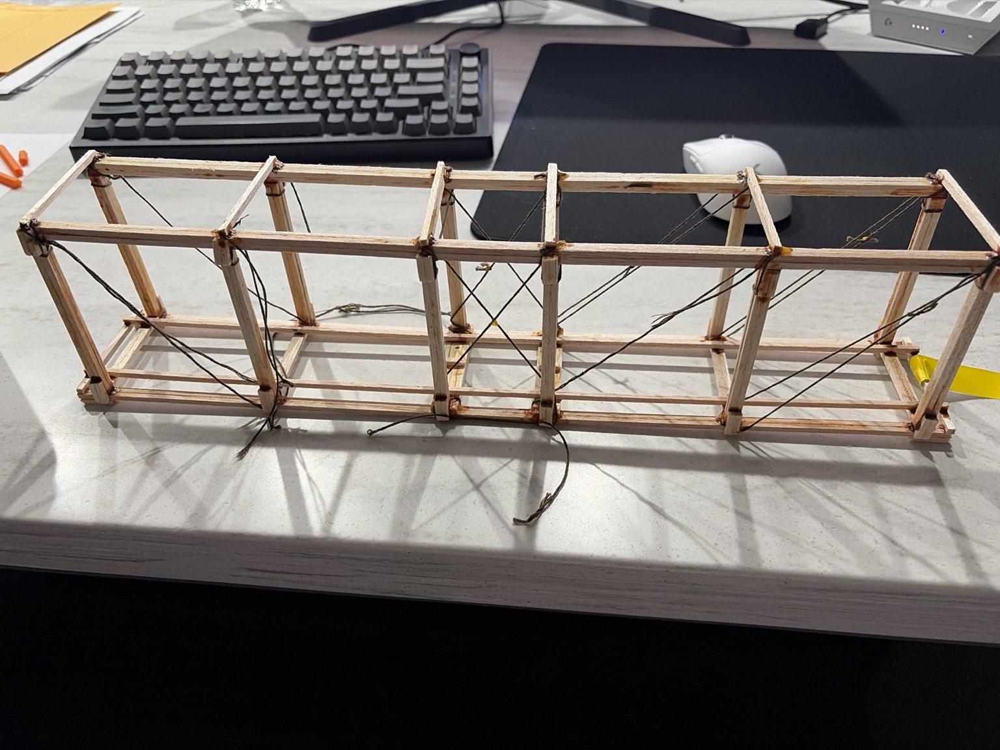
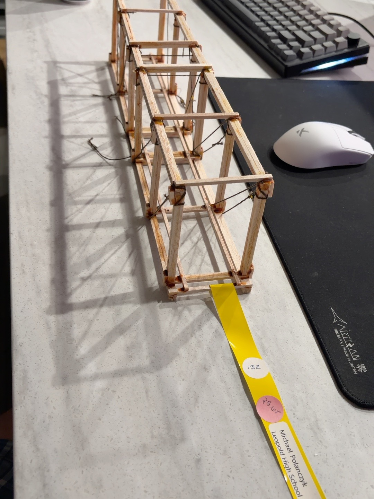

# MoDOT Bridge — Testing and Results

[All projects](../../README.md) · [Project home](README.md) · [Story](build-log.md) · [Photos](photos.md) · [Videos](videos.md) · [Results](results.md) · [Sources](sources.md) · [Portfolio](https://github.com/MadeWithoutCaffeine/Michael-Polanczyk-Portfolio)

**Tested: 13.2 lb supported with a bridge mass of 28.65 g.** Results and observations added November 14, 2026.

## Recorded results

| Field | Recorded result |
| --- | --- |
| Bridge mass | 28.65 g |
| Supported load | 13.2 lb, approximately 5.99 kg |
| Calculated load-to-mass ratio | Approximately 209:1 |
| Official efficiency score | Not confirmed; the ratio below is calculated from my reported measurements. |
| First reported issue | Two strings I had tensioned slightly too tightly; one loosened and another slipped. |
| End of test | Loss of string bracing brought the test to an end. |
| Condition when returned | Frame intact, with next to no visible signs of testing apart from two loose strings. |
| Final dimensions | Not recorded here yet. |
| Inspection outcome / penalties | Not confirmed. |
| Individual / school placing | Not confirmed. |
| Individual test date / time | Not independently recorded; the announced competition date was November 5, 2026. |

## What happened

I made a mistake when tensioning two of the strings: I tightened them slightly too much. During loading, one string loosened and another slipped. That disrupted the rest of the bracing and brought the test to an end at **13.2 pounds**.

When I received the bridge back, it was still intact. Apart from two loose strings, it showed next to no visible signs of having been tested. I did not find the kind of obvious damage I had expected from a bridge reaching the end of a load test.

This is my account of the failure sequence and my inspection after the test. The footage records the test, but it does not isolate the exact knot or anchor movement well enough to establish a more detailed cause. The frame's appearance afterward also does not establish its remaining strength or a higher load capacity.

## Load-to-mass calculation

Using the reported load and bridge mass:

- Supported mass equivalent: 13.2 lb × 453.59237 g/lb = **5,987.42 g**.
- Ratio: 5,987.42 g ÷ 28.65 g = **208.98**, or approximately **209 times the bridge's own weight**.

This is a calculated comparison using consistent units. It is not a confirmed official competition score, and it does not include any unreported penalties or scoring adjustments.

Before testing, I estimated that the bridge might achieve around **90% efficiency**. I had not established a verified scoring basis for that percentage, so I am keeping it as a personal expectation. It is not interchangeable with the calculated 209:1 ratio and is not a measured result.

## Post-test photos and video

[Watch the load test and results clip](videos.md) · [Browse all photos](photos.md)

## What I learned

The result was disappointing because I wanted to find out what the complete bridge could hold. Instead, the test ended with a problem in the way I had tensioned and secured the strings. Seeing the frame still intact afterward made that mistake stand out.

The string connections were part of the structure, and they needed the same attention as the wood and glued joints. A frame can look strong while a small connection determines how the whole bridge performs.

For another build, I would:

- Test small samples of the string anchors and knots before building the final bridge.
- Use a consistent method to set and check tension across the bracing.
- Allow time to inspect for slipping and uneven tension before submission.
- Compare weight and strength through physical tests rather than relying on a predicted capacity.

[Read the full build story](build-log.md)

## Competition reference

MoDOT announced testing for **Thursday, November 5, 2026**, at Southeast Missouri State University's Academic Hall, 900 Normal Avenue, Cape Girardeau, Missouri. Its current competition page confirms that the event took place on November 5. The update date on this page is when I added my account, not the date the videos were captured.

[MoDOT announcement](https://www.modot.org/node/96071) · [MoDOT competition recap](https://www.modot.org/bridge-competition). Checked November 14, 2026.

[All projects](../../README.md) · [Project home](README.md)
