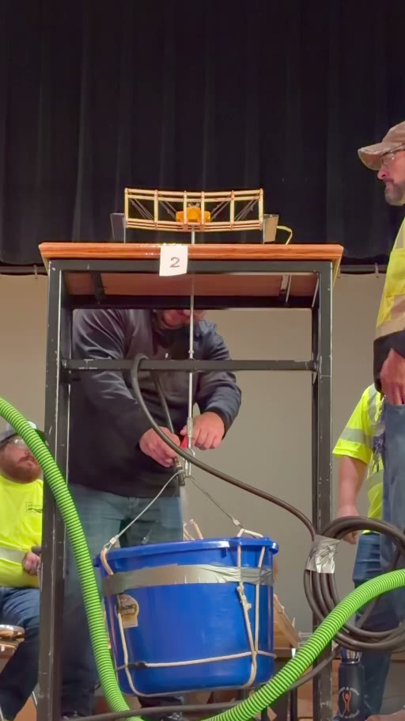
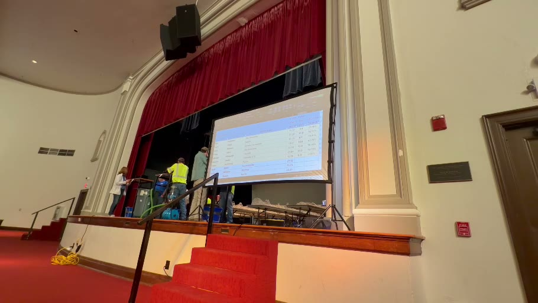
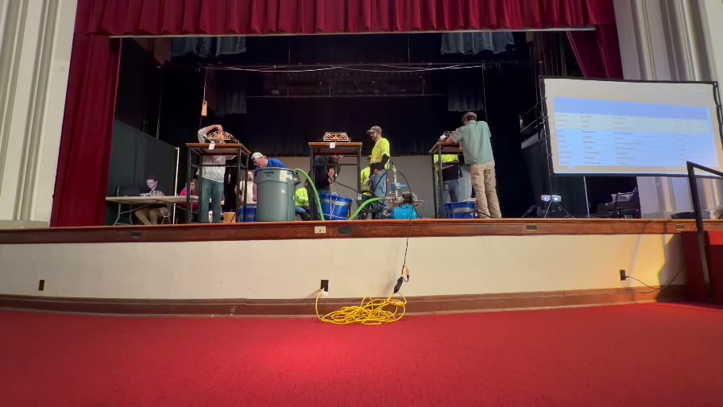

# MoDOT Bridge — Competition Videos

[All projects](../../README.md) · [Project home](README.md) · [Story](build-log.md) · [Photos](photos.md) · [Videos](videos.md) · [Results](results.md) · [Sources](sources.md) · [Portfolio](https://github.com/MadeWithoutCaffeine/Michael-Polanczyk-Portfolio)

Competition footage added November 14, 2026. Select a preview to open the MP4. The links below each preview also provide access to the video.

## Load test · 1 minute 30 seconds

The longer recording shows setup and loading of my bridge. My account of the string tensioning error and the **13.2 lb** result is on the [Results page](results.md).

[Watch or download the load test](https://raw.githubusercontent.com/MadeWithoutCaffeine/Engineering---Projects/main/projects/modot-bridge-2026/media/videos/competition-load-test.mp4) · [Repository file](media/videos/competition-load-test.mp4)

## Results screen · 5 seconds

This short clip shows the projected results. The values recorded in this project are the ones I reported: **28.65 g** bridge mass and **13.2 lb** supported load.

[Watch or download the results clip](https://raw.githubusercontent.com/MadeWithoutCaffeine/Engineering---Projects/main/projects/modot-bridge-2026/media/videos/competition-results.mp4) · [Repository file](media/videos/competition-results.mp4)

## Additional wide view · 23 seconds

A wider view of the competition stage and testing area.

[Watch or download the wide view](https://raw.githubusercontent.com/MadeWithoutCaffeine/Engineering---Projects/main/projects/modot-bridge-2026/media/videos/competition-wide-view.mp4) · [Repository file](media/videos/competition-wide-view.mp4)

## Media notes

| Published video | Source upload |
| --- | --- |
| competition-load-test.mp4 | IMG_3044.mp4 |
| competition-results.mp4 | IMG_3045.mp4 |
| competition-wide-view.mp4 | IMG_3043.mp4 |

The published copies retain the full duration and audio, with smaller file sizes for viewing. IMG_3043(1).mp4 is an alternate upload of the same wide-view recording and is not listed as a separate event. These are the newly supplied competition clips; the earlier build recordings remain unpublished.

[All photos](photos.md) · [Testing and results](results.md) · [Project home](README.md)
