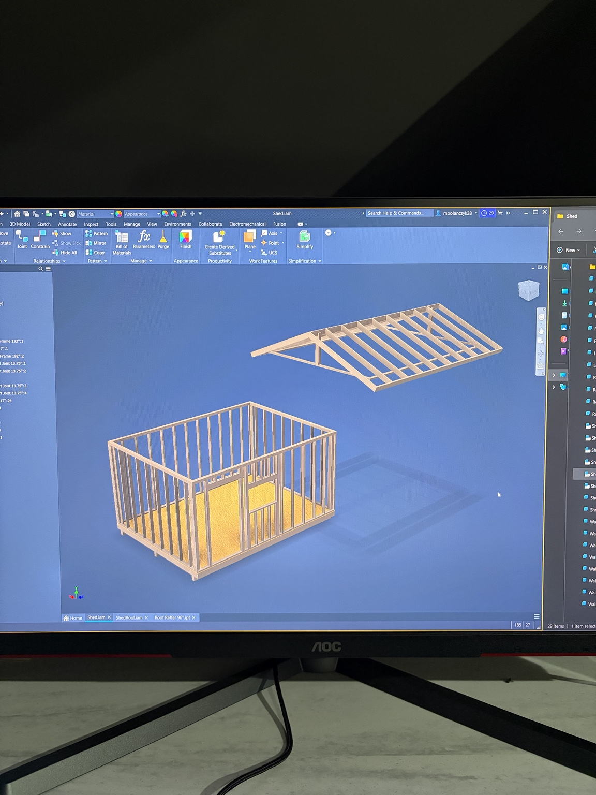

# Portable Workshop Design

[All projects](../../README.md) · [Project home](README.md) · [Design log](design-log.md) · [Current CAD](#current-cad-model) · [Printing setup](#printing-and-computer-setup) · [Portfolio](https://github.com/CodedWithCaffein/Michael-Polanczyk-Portfolio)

I'm designing a portable workshop with an open main workspace and an office that can open or close with a sliding door. I'm working through it in Autodesk Inventor so I can see how the space and framing fit together before spending money on the build.

## At a glance

| Field | Details |
| --- | --- |
| Status | Design in progress · not built |
| Design update | November 12, 2026 |
| Goal | A separate space for my tools, 3D printing, CAD, programming, and projects |
| My role | Dimensions, layout, frame design, roof geometry, portability planning, and CAD modeling |
| Tools | Autodesk Inventor, sketches, and independent research |

## Project guide

| Section | What you'll find |
| --- | --- |
| [Design log](design-log.md) | How I've rethought the design and what still needs work |
| [Current CAD model](#current-cad-model) | A photo of the unfinished framing model |
| [Printing and computer setup](#printing-and-computer-setup) | Equipment I use now and what I want to move into the workshop |

## Why I want the workshop

I currently share an office at home with three other family members. Between everyone's belongings and equipment, it gets difficult to find enough room for my own work and projects. I want a separate space that I can organize around the things I do, with somewhere to keep my tools, printers, and projects between work sessions.

The main workspace will stay open so I can use the floor space efficiently and arrange the work surfaces around my needs. A sliding door will let me close off the office when I want a separate place to work, or leave it open to the rest of the workshop.

## Current CAD model

*Current design shared November 12, 2026. The roof assembly is shown above the walls so the framing is easier to see. This revision is unfinished and still needs adjustments.*

I've rethought the geometry and framing many times while researching how the pieces should fit together. I'm also working through heating systems, insulation, doors, and windows as part of the overall design. The dimensions, frame design, and approach to portability are my own.

CAD gives me a way to check the vision before committing money to materials. It also makes it easier to spot conflicts and change the design while it is still a model. The framing, connections, and other construction details still need work before I can build it.

## Printing and computer setup

I donated my Bambu Lab P1S to my school so other students could use it, learn to make things, and become creators themselves. At home, I now use a **Bambu Lab P2S with an AMS 2 Pro**.

I want to move my 3D-printing equipment into the workshop and build a filament dryer for long-term use. Keeping electricity use low is one of the main goals for that dryer. Its design and actual power use still need to be worked out.

For the office, I'm considering either moving my current desktop setup or building another computer for CAD, programming, and project work. I haven't decided which option makes more sense yet.

## Next steps

- Refine the framing and roof geometry in Inventor.
- Check the overall dimensions, door and window openings, and sliding-door office layout.
- Work through heating, cooling, insulation, and weather sealing.
- Refine the base, connections, and plan for moving the finished workshop.
- Plan the printing area and filament dryer.
- Develop a materials list and cost estimate before buying supplies.

## Credits

ChatGPT helped provide example images during the early planning. I ended up doing more research myself and rethinking the geometry and framing many times. The dimensions, frame design, portability plan, and CAD model are my work. I'm also researching the heating systems, insulation, doors, and windows to make the workshop suit my needs.
